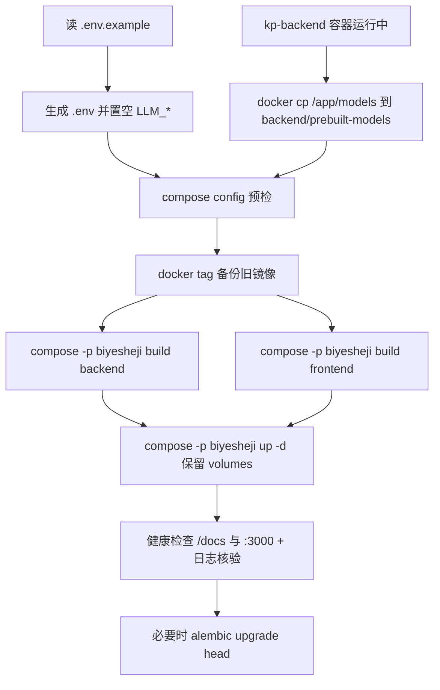

## 需求概述

在本地 Windows 工程 `c:/biyesheji-3.0.0`（中医药知识资源管理与智能问答系统）中，用户已对前后端代码做了增删调整，现在需要**基于当前最新代码重新构建并重启整套 Docker 容器**，使运行状态与新代码一致。

## 已确认的执行前提（用户本轮选择）

1. **模型权重**：从正在运行的 `kp-backend` 容器把 `/app/models` 导出到 `backend/prebuilt-models/`，走 Dockerfile 默认 `MODELS_SOURCE=local` 路径，零网络依赖、版本与原镜像完全一致
2. **环境变量**：由 `.env.example` 生成根目录 `.env`，并把 `LLM_BASE_URL` / `LLM_MODEL` / `LLM_API_KEY` 置空（与当前运行镜像 env 保持一致）
3. **数据保留**：保留全部命名卷（postgres / redis / etcd / minio / milvus / uploads），只更新镜像，不删任何业务数据

## 核心任务

- 补齐构建前置物：`.env`、`backend/prebuilt-models/`
- 以 compose 项目名 `biyesheji` 重新构建 backend / frontend 镜像（沿用现有 Dockerfile 与现有 RAG 依赖链，不改动构建体系）
- 重启容器并验证 7 个服务正常、前后端可访问、数据完整

## 边界与约束（来自 AGENTS.md）

- 最小修改：不重写 Dockerfile / docker-compose.yml，不改变已有镜像构建逻辑与 SSE（citation / delta / done）链路
- 不破坏现有 RAG Baseline（HyDE、BGE-M3 稠密+稀疏、RRF、Reranker、相似度 Gate、Citation）
- 不删除任何已有镜像与数据，破坏性操作前先打备份 tag

## 技术栈选型

沿用项目现有体系，不引入新技术：

| 组成 | 现状 | 说明 |
| --- | --- | --- |
| 容器编排 | Docker Compose v5.5.1（Docker 29.7.2） | 项目名必须固定为 `biyesheji` |
| 后端镜像 | `python:3.12-slim` 多阶段 + uvicorn | 阿里云 pip 源 + PyTorch CPU 源，FlagEmbedding 失败自动回退 |
| 前端镜像 | `node:20-alpine` 两阶段 + Next.js standalone 产物 | 构建期注入 `BACKEND_URL=http://backend:8000` |
| 基础设施 | postgres:15-alpine / redis:7-alpine / etcd v3.5.14 / minio / milvus v2.4.15 | 全部沿用，不重建 |
| 模型权重 | BGE-M3 + BGE-Reranker-v2-m3（共 4.3G）内嵌镜像 | 来自运行中容器导出 |


## 实施方案

### 核心策略

先补两个**必缺失的构建输入**（`.env`、`prebuilt-models`），再用 `-p biyesheji` 复用原数据卷重建前后端镜像，最后只替换 backend/frontend 两个容器，基础设施容器与数据卷全程不动。

### 关键技术决策与理由

1. **必须显式指定 `-p biyesheji`（最关键）**
`docker compose ls` 实测：当前 7 个容器由**已不存在的旧目录** `C:\bi ye she ji\docker-compose.yml` 启动，项目名 `biyesheji`，卷名为 `biyesheji_postgres_data` 等。若不指定：

- 默认项目名会变成 `biyesheji-3.0.0` 的衍生名 → 新建一组空数据卷，用户数据"看起来全丢了"
- `docker-compose.yml` 中写死的 `container_name: kp-*` 会与已存在容器冲突，up 直接失败

2. **模型导出必须在停容器之前完成**
`backend/Dockerfile` 默认 `MODELS_SOURCE=local` 走 `FROM scratch AS models-local` + `COPY prebuilt-models /models`，源目录不存在则构建必失败。磁盘需预留约 9GB（导出副本 4.3G + 镜像层 4.3G）。
3. **不使用 `--no-cache`**
requirements 未变时 pip 层（耗时最长，含 FlagEmbedding/torch）可命中缓存；`COPY src ./src` 层在最后，代码变更只让该层重跑，构建最快。若 requirements 确已改动，Docker 会自动使对应层失效重跑，无需手动干预。
4. **`.env` 采用 UTF-8 无 BOM 写入**
PowerShell 5.1 的 `Set-Content -Encoding utf8` 会带 BOM，可能导致 compose 首个变量解析异常；用 `.NET UTF8Encoding($false)` 或直接改原文件三行。
5. **先打备份 tag 再构建**
新镜像同名 `biyesheji-backend:latest` 会覆盖旧 tag，先 `docker tag` 保留 `:bak-日期`，失败可秒级回滚。
6. **`up -d` 不带 `-v`、不执行 `down -v`**
保证 6 个命名卷全部保留；纯重建不需要 `down`（compose 检测到镜像变化会自动 recreate backend/frontend）。

### 数据流 / 执行链



## 执行要点（防回归）

- **顺序铁律**：导出模型 → 构建 → 重启。容器一旦停止就无法再 `docker cp` 取权重（本机 HF 缓存 `~/.cache/huggingface/hub` 下有 `models--BAAI--bge-m3` / `models--BAAI--bge-reranker-v2-m3`，作为兜底源）
- **构建上下文**：`backend/.dockerignore` 未排除 `prebuilt-models`（仅排除了 `models/`），导出后无需改任何忽略规则即可生效
- **前端依赖**：Dockerfile 已是 `npm ci || npm install`，若用户改过 `package.json` 但未更新 lock，会自动回退 install，无需人工介入
- **验证重点**：后端日志出现 `Application startup complete` 且无 `ImportError`/`ModuleNotFoundError`；容器内 `/app/models` 两个子目录存在；确认 `OMP_NUM_THREADS=2` 生效（避免编码满载饿死 etcd 心跳导致 Milvus 退出）
- **回滚**：`docker tag biyesheji-backend:bak-YYYYMMDD biyesheji-backend` 后 `up -d --force-recreate backend`
- **已知无害告警**：由于旧项目配置路径 `C:\bi ye she ji\` 已不存在，compose 可能输出路径不匹配告警，忽略即可，不影响 build/up

## 目录结构（本次涉及文件）

```
c:/biyesheji-3.0.0/
├── .env                        # [NEW] 由 .env.example 复制，LLM_BASE_URL/LLM_MODEL/LLM_API_KEY 置空；
│                               #       UTF-8 无 BOM。compose backend 的 env_file 依赖此文件
├── .env.example                # [KEEP] 模板文件，不修改，作为后续重建基线
├── docker-compose.yml          # [KEEP] 不改动；执行时用 -p biyesheji 指定项目名
└── backend/
    ├── Dockerfile              # [KEEP] 不改动；沿用 MODELS_SOURCE=local 默认路径
    ├── .dockerignore           # [KEEP] 已排除 venv/tests/uploads/models/.env，无需调整
    └── prebuilt-models/        # [NEW] 由 docker cp 从 kp-backend:/app/models 导出（4.3G）
        ├── bge-m3/             #       BGE-M3 向量化权重
        └── bge-reranker-v2-m3/ #       BGE-Reranker-v2-m3 精排权重
```

> 注：`prebuilt-models/` 已被 `.gitignore`（第 52 行）忽略；`frontend/Dockerfile` 与 `frontend/.dockerignore` 本次无需改动（构建参数由 compose 传入）。